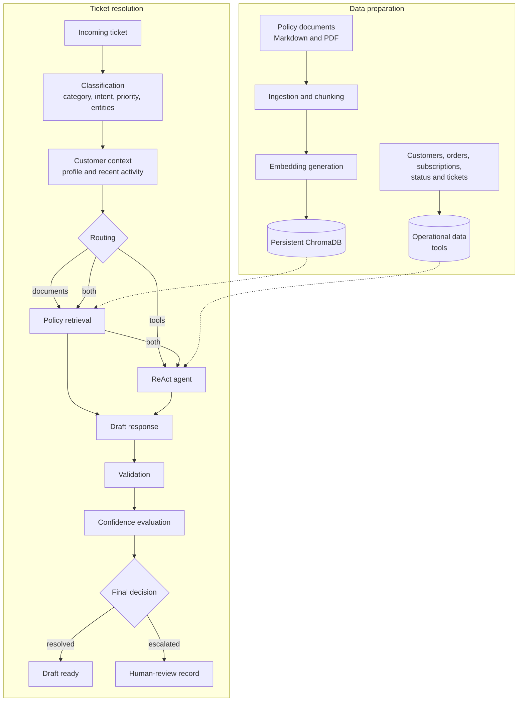

# ResolveAI

ResolveAI is an AI customer-support resolution assistant. It reads an incoming ticket, classifies it, gathers customer and order context through real tools, retrieves the relevant policy, drafts a grounded reply, validates that reply and decides whether it can be resolved or must go to a human.

> **Demo data notice:** the store, customers, orders, subscriptions, incidents and policies in this repository are fictional. ResolveAI never sends messages, issues refunds or modifies accounts; it prepares a draft and, when unsure, creates a human-review record.

## 1. Project Overview

Support teams handle a constant stream of refunds, delivery complaints, billing questions, account lockouts, subscription problems and technical issues. Each one requires reading the ticket, identifying what it is about, looking up the customer and order, finding the applicable policy and writing a careful reply.

ResolveAI automates that preparation while keeping a human in control. It combines retrieval-augmented generation (RAG) over policy documents with a ReAct agent that calls operational tools, then validates the draft and escalates low-confidence or high-risk tickets. The whole workflow is a LangGraph state machine, so every stage and decision is visible and inspectable.

## 2. Problem Statement

A single support question often depends on several disconnected sources: the customer's profile, their order history, subscription state, the refund and delivery policies, and current service incidents. FAQ chatbots answer from static text and cannot check any of it, while a plain LLM call confidently invents policies and order details.

What is missing is a workflow that can decide *what information a ticket needs*, actually fetch it, ground the reply in retrieved policy, check its own work, and hand the ticket to a person when the evidence is not good enough.

## 3. Features

- **Ticket classification** into seven categories with intent, priority and extracted customer/order entities.
- **Conditional routing** between policy retrieval, tool execution, or both.
- **Genuine ReAct loop** where the model selects tools and observes their JSON results.
- **Eight operational tools** over customers, orders, subscriptions, incidents, policies and escalations.
- **Persistent RAG** over Markdown and PDF policy documents using ChromaDB.
- **Customer-aware context** from profile and recent-activity lookups.
- **Response validation** for grounding, completeness and unsupported action claims, with one corrective rewrite.
- **Evidence-based confidence** and human-in-the-loop escalation with persistent review records.
- **Optional LangSmith tracing** with no code changes beyond environment variables.

## 4. Technology Stack

| Purpose | Technology |
| --- | --- |
| Language | Python 3.11+ |
| Interface | Streamlit |
| Agent orchestration | LangGraph (`StateGraph`, conditional edges) |
| LLM | Anthropic Claude via `langchain-anthropic` |
| Retrieval | ChromaDB with a deterministic local embedder and hybrid lexical scoring |
| Document loading | PyMuPDF (PDF), Markdown files |
| Data handling | JSON datasets, Pandas for tabular UI views |
| Configuration | python-dotenv |
| Observability | LangSmith (optional) |

## 5. Project Structure

```text
ResolveAI/
├── src/
│   ├── app.py              # Streamlit interface
│   ├── config.py           # environment settings and validation
│   ├── state.py            # LangGraph state types
│   ├── classifier.py       # category, intent, priority, entities
│   ├── knowledge_base.py   # ingestion, embeddings, persistent ChromaDB
│   ├── retriever.py        # semantic + lexical retrieval
│   ├── tools.py            # the eight support tools
│   ├── agent.py            # LangGraph workflow and ReAct loop
│   ├── response.py         # evidence, drafting, validation
│   └── escalation.py       # confidence and escalation decisions
├── data/
│   ├── customers.json
│   ├── orders.json
│   ├── subscriptions.json
│   ├── system_status.json
│   ├── tickets.json
│   └── knowledge_base/
│       ├── refund_policy.md
│       ├── delivery_policy.md
│       ├── subscription_policy.md
│       └── troubleshooting.md
├── chroma_db/              # generated index (git-ignored)
├── .env.example
├── .gitignore
├── requirements.txt
└── README.md
```

## 6. Architecture



## 7. LangGraph Workflow

The graph is a real `StateGraph`, not a sequence of function calls:

1. `classify` — category, intent, priority and entities.
2. `gather_context` — customer profile and recent activity when relevant, then route.
3. `retrieve` — semantic policy retrieval from ChromaDB (documentation path).
4. `react` — ReAct reasoning and tool execution (operational path).
5. `draft` — evidence-grounded reply generation.
6. `validate` — completeness, citation and policy-consistency checks, with one rewrite.
7. `confidence` — weighted score from observable factors.
8. `decide` — conditional edge to `resolve` or `escalate`.
9. `escalate` — persists a human-review record and keeps the draft.

The RAG and ReAct branches converge at `draft`; only `decide` can end the run.

## 8. Classification and Routing

`classifier.py` returns a category (`billing`, `orders_delivery`, `refunds_returns`, `technical`, `account`, `subscription`, `general`), an intent such as `duplicate_charge` or `account_locked`, a priority (`Low`, `Medium`, `High`, `Critical`), extracted `CUST-`/`ORD-` identifiers, and two routing hints: whether the ticket needs documents and whether it needs tools.

With `ANTHROPIC_API_KEY` set, classification uses a structured-output Claude call; otherwise transparent keyword rules produce the same shape. `gather_context` turns the hints into one of three routes:

| Documents needed | Tools needed | Route |
| --- | --- | --- |
| yes | yes | `retrieve` → `react` |
| yes | no | `retrieve` |
| no | yes | `react` |
| no | no | `react` (general fallback) |

## 9. Customer Context Gathering

When classification reports that customer context is required and a customer ID is known, `gather_context` calls the profile and recent-activity tools and stores a compact customer object in state. If the ID is missing, the context is left empty and the escalation logic treats that as a reason for human review. Every ticket does not call every tool: a general enquiry with no identifiers skips customer lookups entirely.

## 10. RAG Pipeline

Policy knowledge lives in `data/knowledge_base/`. `knowledge_base.py` reads Markdown files section by section (and any PDFs page by page), splits them into 700-character chunks with 120-character overlap, embeds them and writes them to a persistent Chroma collection. Metadata stores the source file, document title, section, category and PDF page.

A SHA-256 manifest signature covers the documents, chunk settings and embedder identity, so the index is only rebuilt when something relevant changes. Retrieval combines normalised vector similarity (60%) with lexical overlap (40%) and optionally filters by category, which keeps exact terms such as "30 days" from being lost.

The embedder is a deterministic local hashing embedder: no model download and no API key. It is a lexical embedding rather than a neural model — a documented limitation, not a hidden one.

## 11. ReAct Agent

The `react` node runs a bounded Reason → Act → Observe loop. With a model configured, the agent is bound to all eight tools; it chooses tool calls, the node executes them for real and returns `ToolMessage` observations, and the model decides whether another call is needed. The loop stops after `MAX_REACT_ROUNDS` (default 3).

Offline, a deterministic planner selects tools from the classification and entities, then executes the same real tool functions. Every result is parsed JSON with a `found` flag and citation sources; failures become observations instead of exceptions.

## 12. Available Tools

| Tool | Actual behaviour |
| --- | --- |
| `search_knowledge_base(query, category?, limit?)` | Hybrid search over the Chroma policy index, returning chunks and scores. |
| `get_recent_system_status()` | Reads service states, uptime and recent incidents from `system_status.json`. |
| `get_customer_recent_activity(user_id)` | Returns the customer's recorded logins, orders, billing events and support contacts. |
| `get_customer_profile(user_id)` | Returns name, email, tier, account status and join date. |
| `get_order_status(order_id)` | Returns item, amount, delivery state, ETA, carrier, tracking and a delay flag. |
| `check_refund_eligibility(order_id)` | Applies the 30-day window, delivery state, digital/final-sale rules and existing-claim checks. It never issues a refund. |
| `get_subscription_details(user_id)` | Returns plan, status, amount, billing cycle and renewal date. |
| `create_support_escalation(ticket_id, reason)` | Appends an open record to `data/escalations.json`, reusing an existing open record for the same ticket. |

## 13. Evidence Aggregation

Retrieved chunks and every tool source are merged into one deduplicated evidence list with stable `[S1]`, `[S2]` labels. The draft prompt receives exactly this list, the UI displays it, and validation checks that the reply cites it. No source is invented: a label only exists because a retrieval hit or a tool returned it.

## 14. Response Validation

`response.py` checks the draft for:

- a non-trivial response that addresses the ticket's wording;
- at least one evidence citation when evidence exists;
- no claim that a refund, cancellation, unlock or message was already completed;
- consistency with `check_refund_eligibility` (no "eligible" promise when it failed);
- presence of order details when the ticket mentions an order ID.

If validation fails and a model is configured, the draft is regenerated once with the issues as instructions; after that the ticket escalates rather than looping.

## 15. Confidence Evaluation

Confidence is computed in `escalation.py` from observable signals, not from a number the model is asked to guess:

| Factor | Weight | Source |
| --- | --- | --- |
| Classification quality | 0.15 | classifier confidence |
| Retrieval relevance | 0.20 | best hybrid retrieval score |
| Tool success | 0.20 | successful / attempted tool calls |
| Evidence sufficiency | 0.15 | number of evidence items |
| Response consistency | 0.25 | validation passed |
| Customer context | 0.05 | profile available when needed |

The score and every factor are shown in the UI with human-readable reasons.

## 16. Human Escalation

A ticket escalates when no draft exists, validation fails, priority is Critical, an account must be unlocked, customer context is required but missing, a refund is requested but ineligible, the ticket is too vague, or confidence is below `CONFIDENCE_THRESHOLD` (default 0.65).

The `escalate` node calls `create_support_escalation`, which writes an open record to `data/escalations.json` and avoids duplicating an existing open record for the same ticket. The generated draft is preserved in the state and shown in the UI for the human reviewer. ResolveAI never sends the draft.

## 17. Environment Variables

| Variable | Purpose | Default |
| --- | --- | --- |
| `ANTHROPIC_API_KEY` | Claude access; without it the app runs offline | empty |
| `LLM_MODEL` | Claude model name | `claude-haiku-4-5-20251001` |
| `LANGSMITH_TRACING` | Enable tracing | `false` |
| `LANGSMITH_API_KEY` | LangSmith credential | empty |
| `LANGSMITH_PROJECT` | Trace project name | `ResolveAI` |
| `CHROMA_DB_PATH` | Persistent index location | `./chroma_db` |
| `KNOWLEDGE_BASE_PATH` | Policy document folder | `./data/knowledge_base` |
| `TOP_K` | Chunks per retrieval | `4` |
| `CONFIDENCE_THRESHOLD` | Escalation cutoff | `0.65` |
| `MAX_REACT_ROUNDS` | ReAct iteration limit | `3` |

Copy `.env.example` to `.env`; `.env` is git-ignored.

## 18. Installation

Requires Python 3.11+ and Git.

```powershell
# Windows PowerShell
git clone https://github.com/Sainath-10/ResolveAI.git
cd ResolveAI
py -3.11 -m venv .venv
.venv\Scripts\Activate.ps1
python -m pip install -r requirements.txt
```

```bash
# Linux / macOS
git clone https://github.com/Sainath-10/ResolveAI.git
cd ResolveAI
python3 -m venv .venv
source .venv/bin/activate
python -m pip install -r requirements.txt
```

## 19. Running the Application

```bash
cp .env.example .env      # add ANTHROPIC_API_KEY if you have one
python -m streamlit run src/app.py
```

Open `http://localhost:8501`. The first run builds the Chroma index from `data/knowledge_base/`; later runs reuse it. Use the sidebar to load a sample ticket, then **Run ResolveAI** to see classification, workflow stages, tool calls, retrieved sources, the draft, validation checks, confidence factors and the escalation status.

## 20. Sample Tickets

| Ticket | Scenario | Expected path |
| --- | --- | --- |
| `TKT-3001` | Duplicate charge on ORD-2041 | Billing, both paths, resolved |
| `TKT-3002` | Return running shoes from ORD-2045 | Refund eligible, resolved |
| `TKT-3003` | Locked account, needs ORD-2043 | Account, escalated for identity verification |
| `TKT-3004` | Desk lamp from ORD-2048 is late | Delivery, resolved with tracking |
| `TKT-3005` | Plus subscription past due | Subscription, resolved |
| `TKT-3006` | Mugs from ORD-2042 arrived broken | Damaged item, escalated (claim already open) |
| `TKT-3007` | Refund for ORD-2047 from September | Refund, escalated (outside 30-day window) |
| `TKT-3008` | "It does not work anymore." | General, escalated (insufficient detail) |

## 21. Limitations

- All customers, orders, subscriptions, incidents and policies are fictional demonstration data.
- The local embedder is lexical hashing, not a neural embedding model; a real deployment would use a neural embedding API.
- Without `ANTHROPIC_API_KEY`, classification and tool selection use deterministic rules; model-driven classification and ReAct require a key.
- The demo datasets are intentionally small (six customers, eight orders, four policy documents).
- The "current date" for refund and delay checks is the timestamp in `system_status.json`, keeping the demo reproducible.
- ResolveAI never sends replies, issues refunds or changes accounts; escalation records are local JSON.
- There is no database, login or multi-user support; it is a single-user local application.
